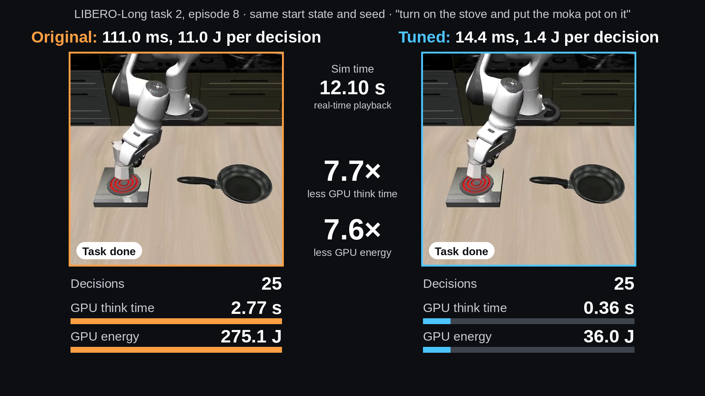
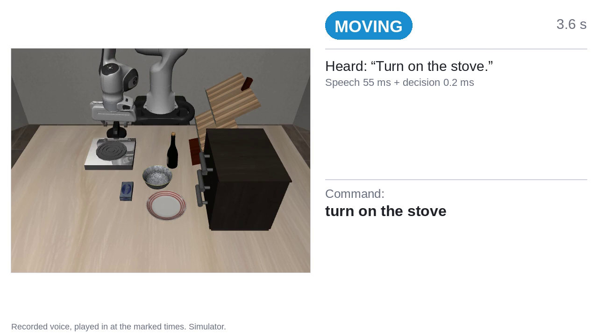
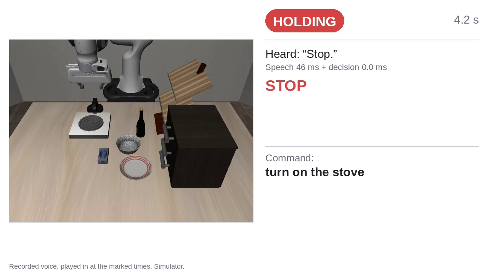
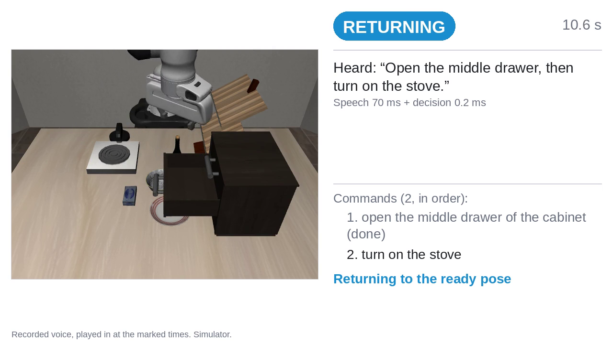
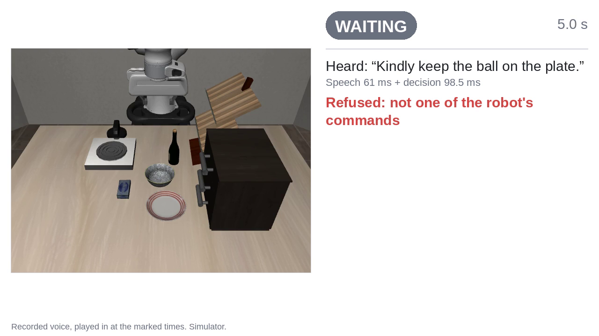

# Efficient SmolVLA on LIBERO: 7.7× faster, 7.6× less energy, and a voice-to-action pipeline

Sisir Kausthubh · November 2026

Two pieces of work on the SmolVLA vision-language-action model (`lerobot/smolvla_libero`) in the LIBERO robot simulator, on one laptop GPU (RTX 5090 laptop, 24 GB):

1. **Speed.** Two existing LeRobot settings plus one small patch of mine, nothing retrained, make each robot decision 7.70× faster and use 7.64× less GPU energy, with the same task success on 400 LIBERO episodes.
2. **Voice to action.** A recorded spoken command goes through Whisper, a small command router and the fast SmolVLA, and the simulated robot does the task. It also handles spoken "stop" and "continue", two commands in one sentence (one of the two tested sentences passed its bar), and refuses what it cannot do.

## Results at a glance

Same laptop, same LeRobot code, same checkpoint (revision `a24f1f38`), batch 1 for speed and energy, 400 closed-loop episodes (4 LIBERO suites × 10 tasks × 10 episodes, seed 1000) for success.

| Pillar | Measure | Original | Tuned | Change |
|---|---|---|---|---|
| Speed | Median time per decision | 111.0 ms | 14.4 ms | 7.70× faster |
| Speed | 99th-percentile latency (p99) per decision | 147.0 ms | 16.8 ms | 8.75× faster |
| Speed | Startup, first call | 0.48 s | 152–161 s cold (compile), 6.5–6.7 s warm (compile cache reused) | slower to start |
| Accuracy | LIBERO success, 400 episodes | 82.00% (328/400) | 82.00% (328/400) | +0.00 percentage points, 95% interval −3.3 to +3.3 |
| Efficiency | GPU energy per decision | 11.00 J | 1.44 J | 7.64× less |
| Efficiency | Peak GPU memory (PyTorch allocated) | 936 MB | 897 MB | lower |

- **Original** is this checkpoint with LeRobot's default settings, run on the same code as Tuned: no compiler, 10 denoising steps, no blank camera slot, each camera image through the vision encoder in its own call (the per-camera loop is put back at run time). Eager speed on plain, unpatched main was not measured for the headline.
- **Tuned** changes three things. Nothing is retrained:
  1. `compile_model=True` (PyTorch `torch.compile`, mode `max-autotune`), an existing LeRobot setting;
  2. `num_steps=1`: one denoising step instead of 10, an existing LeRobot setting;
  3. both camera images go through the vision encoder in one batched call. This is my small port to SmolVLA (`speed/patches/batch_cameras.patch`) of the camera-batching pattern from LeRobot's merged PI0/PI0.5 change, PR #4426 by nepyope. It is not proposed upstream.
- The code as measured also contained LeRobot PR #4634 by NotNANtoN (a static key/value cache and a compiled denoise loop). A related check on 10 Nov: the two LeRobot settings alone (1 step, whole-model compile) ran on plain LeRobot main, without the PR and without camera batching, at 15.4–15.5 ms per decision, against 13.8–14.5 ms for the measured code (speed only). At one denoising step there is little loop for PR #4634 to speed up; its gain is at 10 steps, where it gave 2.2× end to end on this laptop. See [docs/TUNED_WITHOUT_PR4634.md](docs/TUNED_WITHOUT_PR4634.md).
- Speed and energy come from one session in which all setups take turns in mirrored rounds; a repeat session gave 7.60× (speed) and 7.42× (energy). Energy is the GPU's own counter (NVIDIA Management Library), idle power included; above idle the ratio is 7.55×.
- The trade-off is startup: Tuned's first start compiles for about 2.5 minutes. Later starts that reuse the compile cache take 6.5–6.7 s to the first call.
- The 1-step setting keeps accuracy on LIBERO. That is the only place it was measured.

Full numbers, the method and every source file: [docs/RESULTS_SPEED.md](docs/RESULTS_SPEED.md).

## Demos

**Demo 1: the same episode, Original and Tuned side by side.** The counters are decisions so far × the measured median time and energy per decision (from the speed session, not measured inside this episode). Both runs succeed in 242 steps with 25 decisions, so only the cost per decision differs. Click the picture for the video.

[](media/meters_side_by_side_clean.mp4)

**Demo 2: voice to action** (my recorded voice, played into the running system; simulator). Click a picture for its video.

| One spoken command | Stop, then continue |
|---|---|
| [](media/take2_single_stove.mp4) | [](media/take2_stop_continue_stove.mp4) |
| **Two commands in one sentence** | **A misheard word is refused** |
| [](media/take2_two_step_drawer_then_stove.mp4) | [](media/refusal_bowl_heard_as_ball.mp4) |

Also: [a command outside the 10 is refused](media/take2_refused_top_drawer.mp4).

## The voice pipeline

- **Hear.** A recorded line is trimmed of silence and turned into text by Whisper large-v3-turbo.
- **Route.** Word rules first, then the language model Qwen3.5-4B as a multiple choice, map the text to one of LIBERO-Goal's 10 commands, a stop, a continue, or a refusal. "Stop" and "continue" are word rules only. A sentence with "then" is split into two commands.
- **Act.** Tuned SmolVLA does the command in the LIBERO-Goal simulator. On "stop" the arm is held at the pose it had; between two commands it returns to its ready pose.
- All three models run in one program on the one GPU, one after another.

How each part works and why it is built this way: [docs/HOW_IT_WORKS.md](docs/HOW_IT_WORKS.md).

Pass rules were written before the runs ([docs/VOICE_PLAN.md](docs/VOICE_PLAN.md), with every dated amendment). Results: [docs/RESULTS_VOICE.md](docs/RESULTS_VOICE.md).

**Registered first take** (the result judged by the pre-written rules):

| Rule | Result |
|---|---|
| Lines routed right | 5 of 5 |
| Robot does the task (4 command lines × 3 starting layouts) | 11 of 12 |
| Refusal: arm movement in the 3 s after it | 0.35 mm |
| Overrun after "stop" (bar 15 mm) | 1.1 to 14.1 mm |
| Hold after "stop" (bar 5 mm) | within 1.8 mm |
| Delay from the end of the word "stop" to the first held step (bar 300 ms) | 170 ms |
| Task done after "continue" | 11 of 12 |
| "Open the middle drawer, then turn on the stove" | 5 of 5 |
| "Turn on the stove, then put the wine bottle on top of the cabinet" | 3 of 5 (fails the 4-of-5 bar) |

**Second take** (recorded again, louder, for the demo clips; second-take audio only):

| What | Result |
|---|---|
| Lines understood and routed right | 8 of 9 ("bowl" was heard as "ball" and refused) |
| Robot does the task (3 command lines × 3 starting layouts) | 8 of 9 |
| Overrun after "stop" | 5.1 to 9.9 mm in 9 runs |
| Hold after "stop" | within 1.9 mm in 8 runs, 5.05 mm in one |
| Stop delay after the word | 190 ms |
| Task done after "continue" | 9 of 9 |
| "Open the middle drawer, then turn on the stove" | 5 of 5 |
| "Turn on the stove, then put the wine bottle on top of the cabinet" | 3 of 5 (fails the 4-of-5 bar) |
| "bowl" heard as "ball" | refused in 3 of 3 tries; the arm moved 0.35 mm |

Judged by the registered rules on second-take audio alone, two rules would fail: the misheard line makes three of the 12 "does the task" runs refusals, and one hold was 0.05 mm over the 5 mm bar.

**The router on typed text** (pre-registered, test set scored once): right command 100%, wrong command 0%, correct refusal 96.7% (29 of 30), 88% of commands answered without the language model, median 0.011 ms per sentence. Two caveats: one generator wrote all the sentences and the word rules' synonyms overlap with its examples, so 100% is probably optimistic; and one out-of-scope stove request was routed to "turn on the stove" instead of being refused ("wrong command 0%" counts in-scope sentences only). The test sentences are held back so future router versions can be tested on unseen sentences. See [docs/ROUTER_PREREG.md](docs/ROUTER_PREREG.md).

**Side test: one GPU, three models.** Timing only (a fixed synthetic observation, no simulator), with the compiled 1-step SmolVLA on the older 31 Oct software stack (torch 2.11, PR #4634 head `8c4f33e5`, compile mode `default`), not the final checkout. With Whisper or the language model running flat out in a second program, the policy's p99 rose from 14.83 ms to 40.57 ms and 41.47 ms. A simple turn-taking rule (voice jobs start only in the gap between two decisions) brought it back to 14.78–14.86 ms, at an added wait of 23.3 ms on average per spoken command. See [docs/GPU_SHARING.md](docs/GPU_SHARING.md).

## Reproduce

Linux with an NVIDIA GPU. The speed and voice-robot runs ran on Ubuntu with driver 595.99.02, CUDA 13.2 wheels, Python 3.12.13 (the GPU-sharing side test used the older stack named above).

**1. Patched LeRobot checkout** (the exact code measured):

```bash
git clone https://github.com/huggingface/lerobot.git lerobot-fast-voice
cd lerobot-fast-voice
git checkout --detach d490e472a5d1a207cfe0255caaaf74b6d66e4656
git fetch origin pull/4634/head                                            # or fetch the commit itself if the branch has moved
git -c user.name=x -c user.email=x merge --no-commit --no-ff 2d2003349a0347e2b33a533c3b3d7802b9fbd457   # PR #4634, merged but not committed
git apply /path/to/efficient-smolvla-voice-to-action/speed/patches/batch_cameras.patch
export LEROBOT_DIR=$PWD
```

**2. Python environment** (Python 3.12; exact versions in `requirements-lock.txt`, whose header has the same commands):

```bash
uv venv --python 3.12 "$LEROBOT_DIR/.venv"
uv pip install --python "$LEROBOT_DIR/.venv/bin/python" -r requirements-lock.txt \
    --index-strategy unsafe-best-match \
    --extra-index-url https://download.pytorch.org/whl/cu132 \
    --extra-index-url https://download.pytorch.org/whl/cpu
uv pip install --python "$LEROBOT_DIR/.venv/bin/python" --no-deps -e "$LEROBOT_DIR"
```

The environment of the measured runs was built inside the checkout with `uv sync --locked --extra smolvla --extra libero --extra test --extra evaluation --extra training`.

**3. LIBERO assets and models.** Set up LIBERO as LeRobot's own guide describes (`docs/source/libero.mdx` in the checkout). The scripts run with `HF_HUB_OFFLINE=1`, so download the models once first. Revisions in the local cache that ran:

| Model | Revision |
|---|---|
| `lerobot/smolvla_libero` | `a24f1f380461b665158d52acd140152c79e8b36d` |
| `HuggingFaceTB/SmolVLM2-500M-Video-Instruct` (SmolVLA's backbone) | `7b375e1b73b11138ff12fe22c8f2822d8fe03467` |
| `openai/whisper-large-v3-turbo` (voice) | `41f01f3fe87f28c78e2fbf8b568835947dd65ed9` |
| `Qwen/Qwen3.5-4B` (voice) | `851bf6e806efd8d0a36b00ddf55e13ccb7b8cd0a` |

For example: `hf download Qwen/Qwen3.5-4B --revision 851bf6e806efd8d0a36b00ddf55e13ccb7b8cd0a`. System tools: `ffmpeg` (`voice/make_voice_clip.py`; `voice/make_share_audio.sh` needs a build with flite) and `arecord` (`voice/record_lines.py`). The synthetic speech clips are committed.

**4. Paths.** Every script reads these environment variables; none needs editing.

| Variable | Meaning | Default |
|---|---|---|
| `LEROBOT_DIR` | the patched LeRobot checkout | none, must be set |
| `PYTHON` | Python to run with | `$LEROBOT_DIR/.venv/bin/python` |
| `OUT_DIR` | new outputs, so a re-run never overwrites the committed results | `runs/` in this repository (gitignored) |
| `LOG_DIR` | logs | `logs/` in this repository (gitignored) |
| `SCRATCH` | temporary compile caches and scratch checkouts | `${TMPDIR:-/tmp}/efficient-smolvla-voice-to-action` |
| `GPU_LOCK` | lock file, so only one GPU job runs at a time | `/tmp/efficient-smolvla-voice-to-action.gpu.lock` |

```bash
export LEROBOT_DIR=/path/to/lerobot-fast-voice
export PYTHON=$LEROBOT_DIR/.venv/bin/python
export OUT_DIR=$PWD/runs LOG_DIR=$PWD/logs
```

**5. Speed** (from the repository root; times are from the scripts' own comments):

```bash
speed/scripts/run_all.sh        # everything below in order, under the GPU lock: about 2 h
# or one at a time:
flock "${GPU_LOCK:-/tmp/efficient-smolvla-voice-to-action.gpu.lock}" speed/scripts/run_session.sh   # speed + energy session, then the TF32 check: about 15-17 min
flock "${GPU_LOCK:-/tmp/efficient-smolvla-voice-to-action.gpu.lock}" speed/scripts/run_startup.sh   # startup and peak memory, fresh process per run: about 10-12 min
# LIBERO, 400 episodes each, about 35 min each:
flock "${GPU_LOCK:-/tmp/efficient-smolvla-voice-to-action.gpu.lock}" speed/scripts/run_libero_final.sh final_2026-11-07_A1_eager_steps10 --cameras looped \
  --policy.num_steps=10 --policy.empty_cameras=0
TORCHINDUCTOR_FORCE_DISABLE_CACHES=1 TORCHINDUCTOR_CACHE_DIR="$(mktemp -d)" TORCH_LOGS=recompiles,graph_breaks \
  flock "${GPU_LOCK:-/tmp/efficient-smolvla-voice-to-action.gpu.lock}" speed/scripts/run_libero_final.sh final_2026-11-07_B_tuned --cameras batched \
  --policy.compile_model=true --policy.num_steps=1 --policy.empty_cameras=0
$PYTHON speed/scripts/libero_compare.py --help                                        # paired comparison of two runs
$PYTHON speed/scripts/summarize_final.py                                              # collects $OUT_DIR/speed into final_numbers.json
```

`summarize_final.py` expects a repeat session as well (`SKIP_PRECISION=1 speed/scripts/run_session.sh --out-dir "$OUT_DIR/speed/session_pass2"`), the co-location check (`run_colocation_check.sh`, about 9 min, needs `CACHE` set to a warm compile cache), the run logs in `$LOG_DIR`, and, for the comparison with the 31 Oct runs, a copy of `speed/results/reference_2026-10-31/libero_runs/*` in `$OUT_DIR/speed/libero_runs/`.

Outputs go to `$OUT_DIR/speed/`. Follow-up checks (test fix, compile modes, old vs new stack, Tuned on plain main) are in `speed/followups/`; each script's header says what it needs (some need extra LeRobot checkouts, set with the variables named there). `run_tuned_check.sh` also needs `PLAIN_MAIN_SRC`, the `src` folder of a plain LeRobot main clone (the check used main at `81b8c5b`; its SmolVLA files are the same as at `d490e472`).

**6. Voice** (from `voice/`; the registered runs took about 1 to 2 minutes each):

```bash
cd voice
./run_voice_robot.sh --stage stage1 --name stage1      # one command per line
./run_voice_robot.sh --stage stage2a --name stage2a    # stop and continue
./run_voice_robot.sh --stage stage2b --name stage2b    # two commands in one sentence
./run_voice_robot.sh --stage stage1 --name ball_refusal --audio-root data/ball_demo --starts 0
```

These read the committed recordings in `voice/data/voice_test/` and `voice/data/voice_lines/` and write to `$OUT_DIR/voice_robot/<name>/` (watch with `tail -f $LOG_DIR/voice_robot.log`). They reproduce the second-take runs (`*_take2` in `voice/results/voice_robot/`). Eight of the nine recordings are second-take audio; line 3 is the first-take recording the second take fell back to (see [docs/RESULTS_VOICE.md](docs/RESULTS_VOICE.md)). The other first-take audio is not in this repository, so the registered first take can be checked from its saved results but not re-run. The first start compiles the policy (about 2.5 min); later starts reuse `voice/.cache/inductor`.

`record_lines.py` records your own lines into those same folders and renames the committed ones to `*_attempt*.raw`, and `make_share_audio.sh` rewrites `voice/data/share_audio/`. Run them in a separate copy of the repository if you want to keep the committed recordings.

The GPU-sharing test (`voice/run_share.sh`, about 86 minutes for the registered run) needs the held-back router sentences or a sentence file of your own; see [docs/GPU_SHARING.md](docs/GPU_SHARING.md).

**7. Tests** (CPU only, a few seconds):

```bash
PYTHONDONTWRITEBYTECODE=1 $PYTHON -m pytest -q -p no:cacheprovider voice/tests
```

## Repository layout

```
README.md, LICENSE, requirements-lock.txt
docs/        results, plans and pass rules, file notes
speed/
  scripts/   speed, energy, startup and LIBERO runs, summaries
  patches/   batch_cameras.patch (camera batching), pr4634_test_fix.diff
  followups/ follow-up checks (test fix, compile modes, old vs new stack, Tuned on plain main)
  results/   the measured results (json, csv, txt), including per-episode LIBERO results
  clip/      scripts that build Demo 1
voice/
  *.py, *.sh voice robot loop, router, speech, GPU-sharing test
  tests/     CPU-only unit tests
  data/      second-take recordings, the refusal demo recording, synthetic speech clips
  results/   registered and second-take runs (summaries and per-run timelines), router summaries, GPU-sharing runs
  diagnostics/, figures/
slides/      slides_v2.tex and slides_v2.pdf: the deck as presented on 10 Nov 2026 (images and clips come from ../media)
media/       demo videos and poster images
```

What was left out, and the exact path-only changes from the code as run: [docs/FILE_NOTES.md](docs/FILE_NOTES.md).

The slides are kept as presented. Two things in them read differently from this README: the plain-main slide line "15.4 ms, 7.2×" divides numbers from two different sessions (the like-for-like comparison is above), and "measured 7 Nov, not posted yet" was the status on 10 Nov.

## Limits

- **Simulator, not a real robot.** Every result is in LIBERO.
- **Laptop GPU, not a Jetson.** All timing and energy is on a laptop RTX 5090; edge hardware was not tested.
- **Recorded voice, not a live microphone.** Lines were recorded first and played into the running system at set times. A live system also needs time to detect that the speaker has finished; that is not in the stop-delay numbers.
- **Small run counts for the voice work.** 12 runs per stage on 3 starting layouts and 5 per two-step sentence. They show the chain works; they are not a success rate.
- **The second two-step sentence** ("Turn on the stove, then put the wine bottle on top of the cabinet") finished 3 of 5 and fails its bar.
- **The 1-step accuracy claim is measured only on LIBERO.** Other tasks or robots may need more denoising steps.
- **Closed-loop success on plain main was not run.** The 15.4–15.5 ms plain-main number is speed and first-call actions only.
- **Tuned's first start compiles for about 2.5 min.** Warm starts reuse the compile cache.
- Speed is measured at batch 1; the closed-loop evals run at batch 10. On a whole 400-episode run the GPU energy is about equal for both, because the simulator dominates it.

## Credits

- [LeRobot](https://github.com/huggingface/lerobot) (Hugging Face), the code everything here runs on.
- [SmolVLA](https://huggingface.co/lerobot/smolvla_libero), the vision-language-action model and its LIBERO checkpoint.
- [LIBERO](https://libero-project.github.io), the benchmark and simulator.
- [Whisper](https://huggingface.co/openai/whisper-large-v3-turbo) (OpenAI), speech to text.
- [Qwen3.5-4B](https://huggingface.co/Qwen/Qwen3.5-4B) (Qwen team), the router's language model.
- LeRobot PR #4634 by NotNANtoN: static key/value cache and compiled denoise loop for SmolVLA, part of the code as measured.
- LeRobot PR #4426 by nepyope: the PI0/PI0.5 camera-batching pattern that `batch_cameras.patch` ports to SmolVLA.

## Licence

Apache License 2.0, see [LICENSE](LICENSE) (the same licence as LeRobot).
